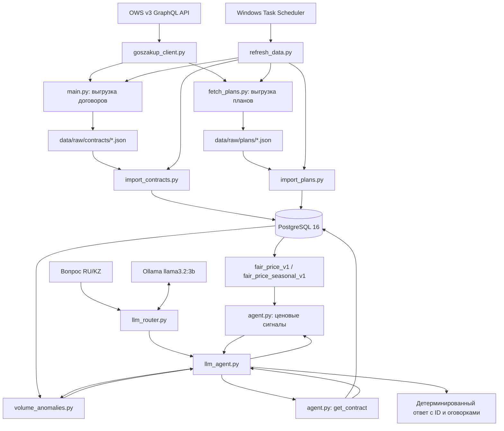

# Архитектура Procurement AI Agent (PoC)

## 1. Назначение и границы

Система отвечает на вопросы по выбранной выборке госзакупок Казахстана и выявляет кандидатов на ценовые и количественные отклонения. Достоверные факты берутся из PostgreSQL, LLM используется прежде всего для определения намерения пользователя. Прототип не принимает юридических решений и не утверждает наличие нарушения на основании одного отклонения.

## 2. Компоненты и потоки данных



`refresh_data.py` управляет порядком запуска ETL; схема выше показывает логические зависимости. Запуск через планировщик Windows является локальным решением для PoC, а не отказоустойчивым сервисом обновления.

## 3. Источник и модель данных

Источник: OWS v3 GraphQL API. Область загрузки: 27 БИН, финансовые годы 2024–2026. Данные сохраняются в JSON для повторного импорта и анализа происхождения.

Основные таблицы:

| Таблица | Основные поля | Назначение |
|---|---|---|
| `contracts` | `id`, `root_id`, `parent_id`, `contract_number_sys`, `customer_bin`, `supplier_bin`, `fin_year`, `sign_date`, `contract_sum`, `raw_data` | Договоры и история версий |
| `contract_units` | `id`, `contract_id`, `plan_id`, `enstru_codes`, `item_price`, `quantity`, `total_sum`, `deleted`, `raw_data` | Товарные позиции договоров |
| `plans` | `id`, `subject_bin`, `fin_year`, `name_ru`, `enstru_code`, `unit_code`, `quantity`, `price`, `amount`, `raw_data` | Данные планов, включая единицу измерения |

Ключевые соединения: `contract_units.contract_id = contracts.id`, `contract_units.plan_id = plans.id`. Для определения актуальной версии договора используется `ROW_NUMBER() OVER (PARTITION BY COALESCE(NULLIF(root_id, 0), id) ORDER BY sign_date DESC NULLS LAST, id DESC)`, затем `rn = 1`.

## 4. ETL и актуализация

1. `main.py` запрашивает договоры по БИН и году с пагинацией GraphQL, записывает JSON.
2. `import_contracts.py` загружает договоры и позиции в PostgreSQL с upsert по ID.
3. `fetch_plans.py` извлекает `plan_id` из позиций, запрашивает планы пакетами и сохраняет JSON, включая сведения об отсутствующих ID.
4. `import_plans.py` загружает планы в PostgreSQL.

`goszakup_client.py` обрабатывает постраничную загрузку и ограниченные повторы сетевых ошибок. `refresh_data.py` запускает четыре скрипта последовательно и прекращает цепочку при ненулевом коде завершения. Флаги `REFRESH_CONTRACTS=1` и `REFRESH_PLANS=1` отключают пропуск уже существующих выгрузок.

**Текущий статус:** локальная ежедневная задача Windows настроена; успешный полный цикл обновления по расписанию не подтверждён. Возможные проблемы: недоступность OWS API, выключенный компьютер, незапущенная БД, изменение набора планов и частично обновлённые JSON при сбое. Upsert не эквивалентен полному согласованию удалённых записей. Требование обновления «не реже 24 часов» нельзя считать гарантированно выполненным без проверки исполнения и мониторинга.

## 5. Аналитика

### 5.1. Фильтрация

Для ценовой аналитики используются позиции актуальных версий договоров с положительными `item_price` и `quantity`, `deleted = 0`, непустым первым кодом ЕНСТРУ `enstru_codes[1]` и `unit_code` из плана. Арифметическая проверка согласованности:

```text
abs(item_price * quantity - total_sum) <= max(1, abs(total_sum) * 0.01)
```

### 5.2. Сезонный бенчмарк

Сезон определяется по `contracts.sign_date`:

| Сезон | Месяцы |
|---|---|
| winter | 12, 1, 2 |
| spring | 3, 4, 5 |
| summer | 6, 7, 8 |
| autumn | 9, 10, 11 |

`fair_price_seasonal_v1` вычисляет **медиану** по `enstru + unit_code + season` при наличии не менее пяти разных договоров, иначе использует глобальную медиану по `enstru + unit_code` (также минимум пять договоров). Для 57 010 позиций с бенчмарком сезонный уровень доступен для 35 028, глобальный fallback — для 21 982.

В `get_anomalies()` и `explain_anomaly()` рассчитывается **другой показатель** — средневзвешенная цена по количеству, с исключением всех позиций **того же договора** из группы сравнения:

```text
weighted_price =
    (sum(price * quantity) - sum_own_contract(price * quantity))
    / (sum(quantity) - sum_own_contract(quantity))
```

Сначала выбирается сезонная группа, если после исключения собственного договора осталось не менее 10 сопоставляемых позиций и цена положительна. Иначе применяется глобальная группа. Поиск ценовых сигналов использует порог `price > weighted_price * 1.30` и дополнительный демонстрационный фильтр `price < weighted_price * 3`. Процент отклонения: `(price / weighted_price - 1) * 100`.

**Техническая оговорка:** SQL поиска ценовых аномалий сейчас использует строки `fair_price_seasonal_v1` как исходную выборку. Поскольку представление само фильтрует позиции по доступности медианного бенчмарка, это может сужать глобальную группу по сравнению с исходными позициями. Покрытие представления не равно покрытию выдачи агента. Сезоны разных лет объединены, инфляция отдельно не нормализуется.

### 5.3. Аномалии объёма

`get_volume_anomalies()` сравнивает количество с медианой по `enstru + unit_code`. Группа должна включать минимум 10 позиций и 5 разных договоров. Сигнал: `quantity > median_quantity * 3`. Медиана группы включает оцениваемую позицию. Сильное отличие количества может быть вызвано разными потребностями организаций.

### 5.4. Региональная корректировка

В доступных JSON договоров и планов нет подтверждённого поля региона **фактической поставки**. Поэтому региональная корректировка **не реализована**. Предполагаемое расширение: добавить в ETL проверенный код региона поставки и вычислять бенчмарки внутри `enstru + unit_code + region + season` с fallback при недостаточной выборке. Регион регистрации заказчика не должен автоматически подменять регион поставки.

## 6. Обработка естественного языка

`llm_router.py` обращается к локальной Ollama (`llama3.2:3b`, JSON-ответ, температура 0), выбирая одно из намерений:

- `get_contract`
- `get_anomalies`
- `explain_anomaly`
- `get_volume_anomalies`
- `unknown`

Для запросов с ID выполняется проверка, что ID присутствует в вопросе. `llm_agent.py` вызывает соответствующую Python/SQL-функцию и формирует детерминированный ответ на RU/KZ. LLM не должна придумывать договоры, суммы, цены или выводы о правонарушениях. `unknown` нужен для запросов вне поддерживаемых сценариев.

## 7. Внутренняя оценка

- **47/50 (94%)** — правильная маршрутизация на 50 размеченных RU/KZ вопросах. Ошибки обнаружены в отдельных казахских запросах о дорогих закупках и отклонениях цены.
- **35/35** — соответствие семи полей ответа данным SQL для пяти выбранных договоров.
- **35/35** — отдельные проверки фактов по тем же пяти договорам.

Эти результаты нельзя агрегировать в общую accuracy. Не выполнена независимая репрезентативная оценка всех типов ответов на критерий ≥85%: требуются согласованные эталонные вопросы, определения ошибок и правила оценивания неопределённости.

## 8. Развёртывание и безопасность

Текущее развёртывание: Docker Compose с `postgres:16` и контейнером агента. PostgreSQL публикуется только на `127.0.0.1:5432`, данные БД хранятся в Docker volume. Ollama работает на хосте и доступна контейнеру агента через `host.docker.internal` (Docker Desktop). CLI запускается через `docker compose run --rm --no-deps agent`.

Секреты (OWS API token, пароль БД) хранятся в `.env`, не должны попадать в репозиторий, Docker-образ, логи или публичные примеры. В production необходимы управление секретами, ограничение сетевого доступа, резервное копирование, наблюдаемость и контроль доступов.

**Kubernetes:** потенциальный вариант дальнейшего развёртывания. Для ETL подойдёт `CronJob`, для постоянно доступного API-агента — `Deployment` и `Service` после выделения HTTP API из CLI. Текущий CLI нельзя без изменений считать готовым HTTP-сервисом. Манифесты и работающий Kubernetes-кластер в рамках PoC отсутствуют.

## 9. Что потребуется для промышленного внедрения

1. Подтверждённые поля региона поставки и, при необходимости, дат фактической поставки.
2. Экспертная нормализация сопоставимости товаров и единиц измерения, проверка ценовых выбросов и учёт времени/инфляции.
3. Надёжный планировщик, логирование, мониторинг свежести данных, повторы, алерты и контроль целостности ETL.
4. Независимый эталонный набор RU/KZ вопросов с критериями фактической точности.
5. Выделенный API и инфраструктура развёртывания при необходимости интеграции с внешними системами.

## 10. Принцип интерпретации

**«Цена отклоняется от статистического ориентира» ≠ «закупка проведена по завышенной цене» ≠ «обнаружено нарушение».** Без характеристик товара, условий поставки и независимой экспертизы система должна сообщать об ограничениях, а не делать категорические выводы.
